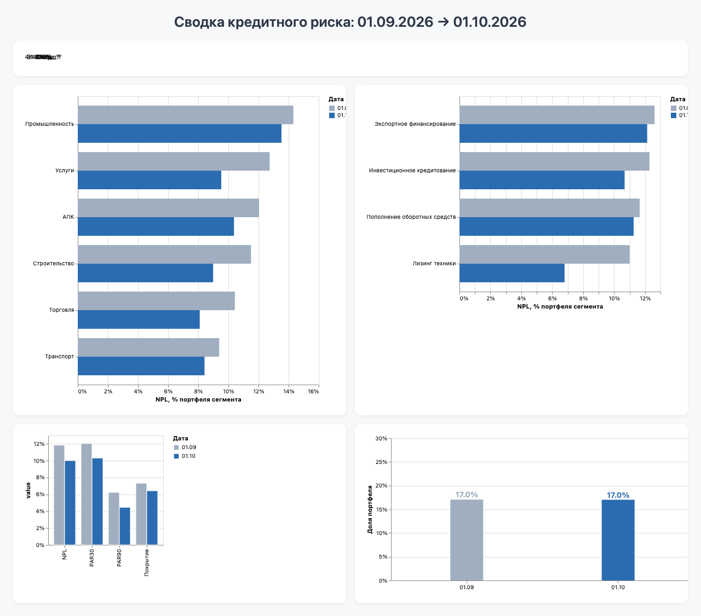

# Риск-сводка кредитного портфеля

Расчёт и визуализация метрик кредитного риска по синтетическому портфелю на два среза: 01.09.2026 и 01.10.2026.



## Как запустить

Нужны: Docker, Python 3.10+, `make`. Для скриншота дополнительно Playwright.

```bash
pip install -r requirements.txt
make all      # БД, загрузка CSV, вьюхи, проверки, verify.py, экспорт JSON для дашборда
make shot     # скриншот docs/dashboard.png (нужен Playwright: playwright install chromium)
```

Дашборд:

```bash
cd dashboard && python3 -m http.server 8000
```

Откройте http://localhost:8000/index.html. Страница использует относительные пути `data/*.json`, поэтому открывать файл двойным кликом не нужно.

Все шаги идемпотентны: вьюхи создаются через `CREATE OR REPLACE VIEW`, загрузка `raw` очищает таблицы перед `COPY`. Повторный запуск даёт те же цифры.

## Итоговые цифры

| Показатель | 01.09.2026 | 01.10.2026 | Изменение |
|---|---|---|---|
| Портфель, млрд ₸ | 498,15 | 484,67 | −2,7% |
| PAR30 | 12,05% | 10,33% | −1,72 п.п. |
| PAR90 | 6,24% | 4,46% | −1,78 п.п. |
| NPL | 11,85% | 10,01% | −1,84 п.п. |
| Провизии, млрд ₸ | 36,51 | 31,17 | −14,6% |
| Покрытие провизиями | 7,33% | 6,43% | −0,90 п.п. |
| Концентрация топ-10 групп | 17,04% | 17,02% | −0,02 п.п. |
| Реструктурировано, млрд ₸ | 27,94 | 26,89 | −3,8% |
| Кредитов в витрине | 1 975 | 1 992 | +17 |

Определения: портфель — остаток в тенге по курсу на дату среза без списанных кредитов; PAR30/PAR90 — доля портфеля с просрочкой более 30/90 дней; NPL — доля с просрочкой более 90 дней или реструктурированных; провизии — остаток × ставка (1% до 30 дней, 10% при 31–90, 50% для NPL); концентрация — доля десяти крупнейших групп `group_id`.

## Выводы для риск-комитета

1. **NPL снизился с 11,85% до 10,01%.** Просрочка 90+ сократилась на 9,46 млрд ₸ (с 31,10 до 21,64). 53 кредита на 15,29 млрд ₸ вернулись в график, 6 кредитов на 1,06 млрд ₸ списаны. При этом приток новой просрочки 90+ составил 7,48 млрд ₸, из них 2,96 млрд ₸ (13 кредитов) — кредиты, которые были списаны на 01.09 и вернулись в портфель на 01.10. Улучшение реальное, но часть его компенсирована этим возвратом.
2. **Реструктурированный блок почти не изменился** (27,94 → 26,89 млрд ₸, около 5,6% портфеля). Это 47% NPL на 01.09 и 55% на 01.10, то есть главный остаточный риск.
3. **Покрытие провизиями снизилось с 7,33% до 6,43%.** Провизии упали на 14,6% при сокращении портфеля на 2,7%. Достаточность резервов зависит от устойчивости выхода из просрочки и от качества реструктурированных кредитов.

## Как проверены цифры

- `scripts/verify.py` считает все метрики на pandas напрямую из CSV, независимо от SQL, и сравнивает с витринами PostgreSQL. При расхождении возвращает ненулевой код, при полном совпадении — 0. Результат входит в `make all`.
- `scripts/transition.py` строит таблицу миграции просрочки (приток, отток, возврат в график, списание, курс). Из неё взяты цифры вывода 1.
- Исправленные в ходе работы ошибки (например, пропавший NPL из-за сравнения флагов с `'YES'`: 4,92% вместо 10,01%) описаны в `docs/ai_notes.md`.

## Допущения по данным

- Дубликаты строк удалены, списанные кредиты (`written_off = 1`) исключены из портфеля. После очистки в витрине 1 975 и 1 992 кредита.
- Курс берётся as-of: последний курс не позже даты среза (`LATERAL JOIN` к `raw.fx`). Подстановки курса по умолчанию нет.
- 13 кредитов были списаны на 01.09 и присутствуют в портфеле на 01.10. Это особенность данных, они учтены как приток и выделены в выводе 1.

## Структура репозитория

```
data/raw/              исходные CSV (portfolio.csv, fx.csv)
sql/                   загрузка в raw, вьюхи reporting
semantic/portfolio.yml семантическая модель поверх reporting.v_loans_clean
dashboard/             index.html и Vega-Lite спеки (*.json), data/*.json
scripts/               verify.py, transition.py, export_kpi.py, screenshot.py
docs/                  dashboard.png, ai_notes.md
CLAUDE.md              инструкции для агента, с которыми велась работа
Makefile               up, load, views, check, verify, export, shot
```

## Работа с ИИ

Проект сделан с помощью ИИ-агента. Инструкции агенту лежат в `CLAUDE.md`, найденные и исправленные ошибки — в `docs/ai_notes.md`.